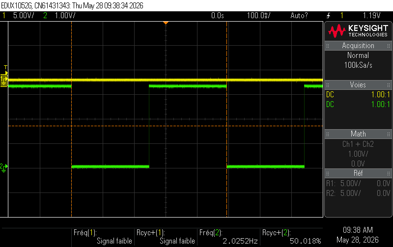
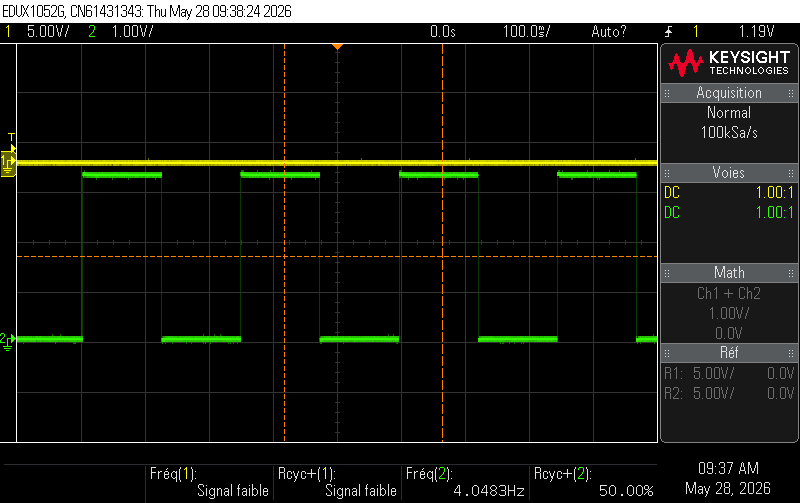

# Smart Car

Programme embarqué d'une voiture radiocommandée, pilotée en Bluetooth depuis un smartphone. La carte est une STM32 Nucleo-L476RG, programmée en C++ avec le framework Arduino.

Projet réalisé en binôme en 1re année de BUT GEII (IUT de Toulouse, 2025-2026), pour la partie informatique embarquée de la SAÉ Smart Car. Le projet suit un cycle en V : cahier d'exigences, analyse fonctionnelle, conception de chaque fonction, puis tests unitaires à l'oscilloscope.

## Ce que fait le programme

Le smartphone affiche une interface [RemoteXY](https://remotexy.com) : un joystick, un bouton de klaxon et un bargraphe. La carte échange avec le module Bluetooth par une liaison série à 9600 bauds.

| Fonction | Rôle |
|---|---|
| `pwm_propulsion` | Commande le moteur en PWM, en marche avant ou arrière, proportionnellement au joystick. Une zone morte de 10 % au centre évite les départs involontaires. En marche arrière, la consigne est divisée par deux à moyenne distance d'un obstacle et annulée quand il est près. Tant que la voiture continue de se rapprocher, un freinage actif applique la consigne maximale en sens inverse. Le moteur n'est commandé que si la liaison Bluetooth est active. |
| `gestion_buzzer` | Radar de recul sonore : 2 bips par seconde à moyenne distance, 4 bips par seconde quand l'obstacle est près, silence quand il est loin. Le klaxon du smartphone est prioritaire. Les temporisations utilisent `millis()`, sans bloquer la boucle principale. |
| `gestion_bargraphe` | Convertit la tension batterie (CAN 12 bits) en niveau de 0 à 100 % affiché sur le smartphone : batterie vide sous 2,5 V, pleine au-dessus de 3 V, linéaire entre les deux. |

La direction et la gestion des phares sont écrites mais pas encore validées : elles restent en commentaire dans le code. Le capteur de distance avant et le capteur de température I2C ne sont pas traités.

## Mesures

Sortie de commande du buzzer, relevée à l'oscilloscope (voie 2).

Obstacle à moyenne distance, 2 Hz :



Obstacle près, 4 Hz :



## Brochage

| Signal | Broche | Sens |
|---|---|---|
| PWM propulsion avant | D4 | sortie (TIM3) |
| PWM propulsion arrière | D5 | sortie (TIM3) |
| Commande du buzzer | D9 | sortie |
| Obstacle près | D7 | entrée |
| Obstacle loin | D8 | entrée |
| Signal de sens arrière | A1 | entrée |
| Niveau batterie | A4 | entrée analogique |
| Capteur de luminosité | A0 | entrée analogique |
| Module Bluetooth (RX, TX) | D12, D13 | liaison série logicielle |
| I2C (SDA, SCL) | D14, D15 | bus |

## Organisation du dépôt

- `src/projet_etudiant_smartcar.cpp` : le programme.
- `platformio.ini` : configuration de la carte et de la compilation.
- `lib/RemoteXY` : bibliothèque RemoteXY 4.1.6, fournie avec sa licence.
- `docs` : relevés d'oscilloscope.

## Compiler et téléverser

Le projet s'ouvre avec PlatformIO (extension de VS Code).

```bash
pio run                  # compilation
pio run --target upload  # téléversement sur la Nucleo
```

## Crédits

Le squelette du projet et le cahier des charges ont été fournis par l'IUT. La bibliothèque RemoteXY appartient à ses auteurs et reste sous sa propre licence (voir `lib/RemoteXY`).
